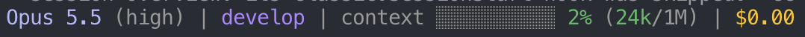
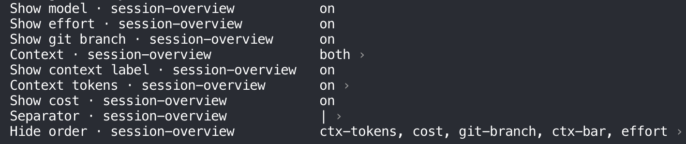

# session-overview

A colored row above the Claude Code prompt, in the terminal, showing at a glance what the session
runs on and how full it is:

```
Opus 5.5 (high) | develop | context ████░░░░░░ 42% (84k/200k) | $1.23
```



## Contents

- [What the row shows](#what-the-row-shows)
- [Install](#install)
- [Update](#update)
- [Settings](#settings)
- [Narrow terminals: the hide order](#narrow-terminals-the-hide-order)
- [Colors and themes](#colors-and-themes)
- [Good to know](#good-to-know)
- [Changelog](CHANGELOG.md)

## What the row shows

| Part | Example | Where it comes from |
|---|---|---|
| Model | `Opus 5.5` | The model of the session, as `/model` shows it. |
| Effort | `(high)` | The effort level, beside the model. It follows `/effort` and the level saved for each model. |
| Git branch | `develop` | The branch of the folder the session works in, or the short commit when no branch is checked out. In a git worktree, the branch checked out in that worktree. Nothing outside a git repository. |
| Context label | `context` | The word before the bar. |
| Context bar | `████░░░░░░` | How full the context window is, in ten cells. |
| Context percentage | `42%` | The same, as a number. |
| Context tokens | `(84k/200k)` | Tokens used, out of the model's context window. |
| Cost | `$1.23` | The estimated cost of the session so far. |

The row updates on its own: after each response, when you switch model or effort, when you change
folder or branch, and about a second after `/compact`.

## Install

The plugin comes from the `mlemolt-plugins` marketplace. Add the marketplace once, then install the
plugin:

```bash
claude plugin marketplace add MaximeLemolt/claude-code-plugins
```

```bash
claude plugin install session-overview@mlemolt-plugins
```

Then start a new `claude` session in a terminal: the row shows above the prompt.

## Update

```bash
claude plugin marketplace update mlemolt-plugins
```

```bash
claude plugin update session-overview@mlemolt-plugins
```

Then start a new session, or run `/reload-plugins` in the current one.

## Settings

Open `/config` in a session and scroll to the **session-overview** rows. A change applies at once.



| Setting | Values | Default | What it does |
|---|---|---|---|
| Show model | on / off | on | Shows the model name. |
| Show effort | on / off | on | Shows the effort level beside the model. |
| Show git branch | on / off | on | Shows the current branch. |
| Context | `both`, `bar`, `percent`, `off` | `both` | Shows the context as a bar and a percentage, one of them, or not at all. |
| Show context label | on / off | on | Shows the word `context` before the bar. |
| Show context tokens | on / off | on | Shows the tokens used and the window, e.g. `(84k/200k)`. |
| Show cost | on / off | on | Shows the estimated session cost. |
| Separator | any text | `\|` | Drawn between the parts, with a space on each side, e.g. `•` or `/`. Empty restores `\|`. |
| Hide order | a list of parts, or `none` | `ctx-tokens, cost, git-branch, ctx-bar, effort` | Which parts to hide first when the terminal is too narrow. See below. |

For example, a minimal row with only the model and the percentage:

```
Opus 5.5 | 42%
```

is **Show effort** off, **Show git branch** off, **Context** `percent`, **Show context label** off,
**Show context tokens** off and **Show cost** off.

## Narrow terminals: the hide order

When the row is wider than the terminal, parts are hidden one by one, in the order given by
**Hide order**, until the row fits. A part that is not in the list is never hidden. If the branch
is still too long after that, it is shortened with an ellipsis: `feature/long-bra…`.

The parts you can list:

| Name | Part |
|---|---|
| `model` | Model |
| `effort` | Effort |
| `git-branch` | Git branch |
| `ctx-label` | The word `context` |
| `ctx-bar` | Context bar |
| `ctx-percent` | Context percentage |
| `ctx-tokens` | Context tokens |
| `cost` | Cost |

Type them in any order, separated by commas or spaces. Case does not matter, and a part typed twice
counts once: `/config` saves the list in a clean form, so `CTX-TOKENS ,cost  git-branch` becomes
`ctx-tokens, cost, git-branch`. A name it does not know is refused and the setting keeps its value.

- `none` hides nothing: the row may then wrap in a narrow terminal.
- An empty value restores the default, `ctx-tokens, cost, git-branch, ctx-bar, effort`.
- The effort only shows beside the model, and the label and tokens only beside the bar or the
  percentage: hiding the model hides the effort too, and hiding both the bar and the percentage
  hides the whole context.
- With every part hidden, the row is not drawn at all.

With the default order, the row shrinks like this as the terminal narrows:

```
Opus 5.5 (high) | develop | context ████░░░░░░ 42% (84k/200k) | $1.23
Opus 5.5 (high) | develop | context ████░░░░░░ 42% | $1.23
Opus 5.5 (high) | develop | context ████░░░░░░ 42%
Opus 5.5 (high) | context ████░░░░░░ 42%
Opus 5.5 (high) | context 42%
Opus 5.5 | context 42%
```

## Colors and themes

The row takes its colors from the theme chosen with `/theme`, so it reads well on a dark or a light
background, with the colorblind-friendly themes, the ANSI themes, and when the theme follows the
system.

| Part | Theme color |
|---|---|
| Model | suggestion (blue) |
| Git branch | merged (purple) |
| Cost | warning (amber) |
| Effort, label, separators, empty bar cells | dimmed text |

The bar, the percentage and the tokens change color as the context fills:

| Context | Color | Meaning |
|---|---|---|
| below 45% | success (green) | Plenty of room. |
| 45 to 60% | warning (yellow) | Getting full. |
| 60 to 80% | Claude orange | Time to hand the work over to a fresh session. |
| 80% and above | error (red) | Nearly full. |

## Good to know

- **Terminal only.** The row is drawn in the terminal. In the Claude desktop app the plugin stays
  idle and reads nothing.
- **After `/compact`.** The old figure is dimmed for about a second, until the new one is known.
  After an automatic compaction, the figure updates with the response that follows.
- **The figures.** The context and the cost are the ones Claude Code reports. The percentage can
  differ by a point or two from `/context`, which counts differently.
- **Effort.** Between turns, the row shows the effort really used on the last turn. A new choice with
  `/effort` or the effort picker shows at once.
- **Nothing shows?** Check that the plugin is enabled with `claude plugin list`, then start a new
  session. A plugin that fails to load says so in `claude --debug`.
